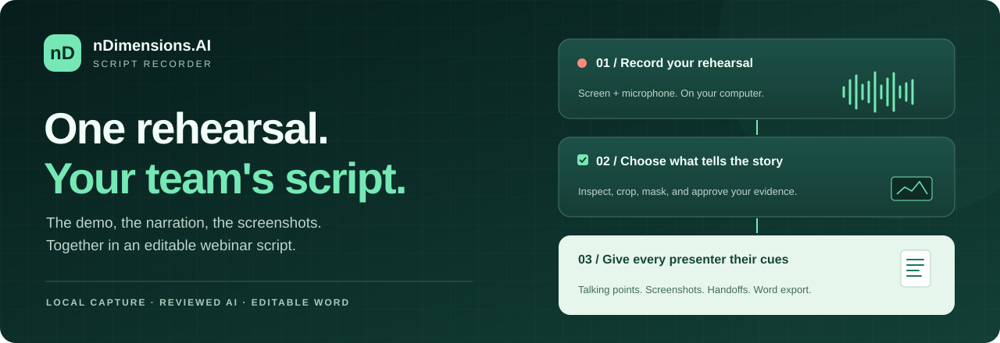
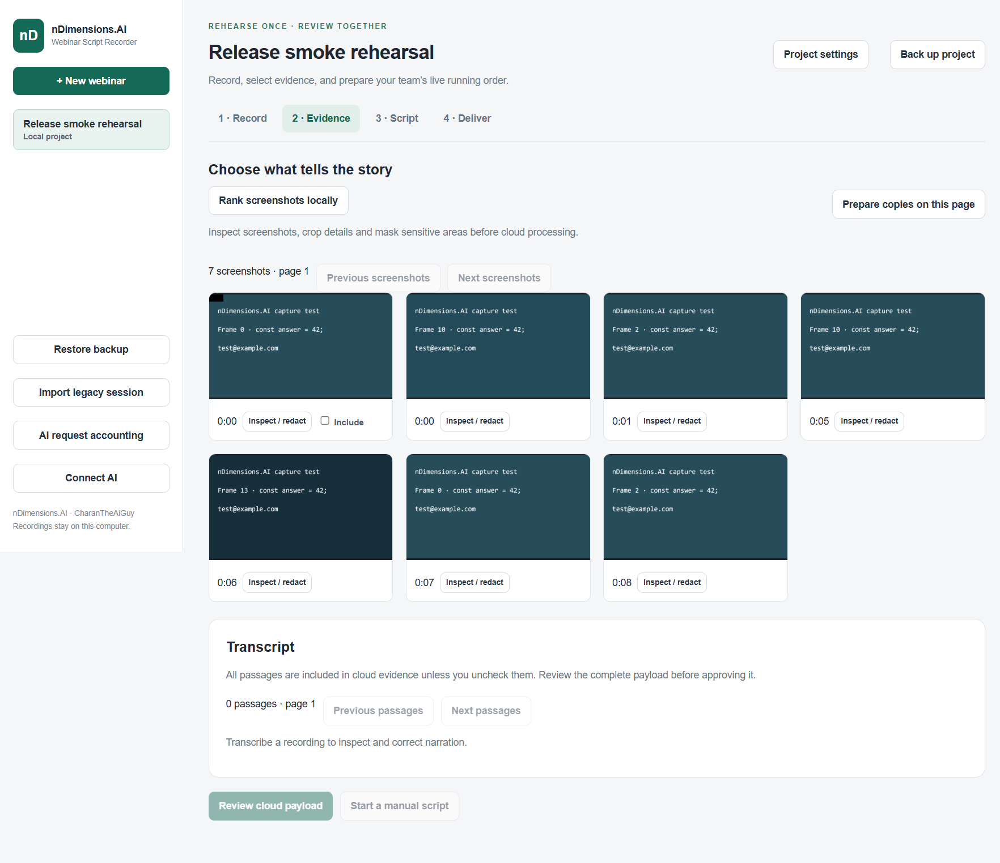
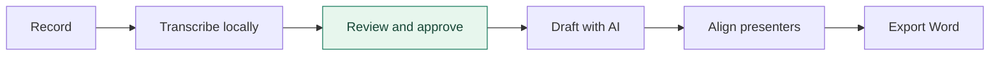

<p align="center">
  
</p>

<h1 align="center">nDimensions.AI Script Recorder</h1>

<p align="center">
  <strong>Turn the demo you rehearse into the script your team delivers.</strong><br />
  Record your screen and narration. Review the evidence. Export an editable Word script with screenshots and presenter handoffs.
</p>

<p align="center">
  <a href="https://github.com/nDimensions-AI/script-recorder/actions/workflows/checks.yml"></a>
  <a href="LICENSE"></a>
  <a href="INSTALL.md"></a>
  <a href="docs/release-qualification.md"></a>
</p>

<p align="center">
  <a href="#quick-start">Quick start</a> ·
  <a href="#the-workflow">Workflow</a> ·
  <a href="#what-stays-local">Privacy</a> ·
  <a href="#documentation">Documentation</a> ·
  <a href="#contribute">Contribute</a> ·
  <a href="https://github.com/nDimensions-AI/script-recorder/issues">Report a bug</a>
</p>

---

## Your rehearsal already contains the story

The command that failed. The fix that worked. The VS Code window everyone needs to see. The explanation that made it click.

Script Recorder brings those moments into one workflow. Rehearse once as the narrator, then shape the result into a running order for three or four presenters. Keep your actual screenshots beside the talking points, assign each section, and make the handoffs explicit before going live.

Built by **nDimensions.AI and CharanTheAiGuy** for webinar teams, technical educators, developer advocates, and anyone presenting a live demonstration.

## What you can do

| Capability | What it gives your team |
| --- | --- |
| **Record the real demo** | Capture a display and microphone, pause and resume, and mark important moments. |
| **Transcribe locally** | Turn narration into timestamped text on your computer with Whisper. Correct it against source playback. |
| **Choose the right screenshots** | Rank candidates, inspect full-size images, crop details, and apply solid masks. Local OCR can suggest sensitive-text masks. |
| **Draft with reviewed evidence** | Approve the exact text and screenshot copies that Gemini can receive. The app manages model selection and estimates. |
| **Coordinate presenters** | Assign sections, review retakes, add producer cues, and check handoffs and estimated timing. |
| **Keep control of revisions** | Save edits, compare proposals, and review changes before they become the current script. |
| **Deliver an editable script** | Export Word documents with embedded screenshots and source references, as a Draft or an approved Ready revision. |
| **Keep projects portable** | Back up and restore local projects, or import a legacy recorder session. |

## See the workspace

<p align="center">
  
</p>

<p align="center"><sub>Actual application screenshot using synthetic demo content. Your recordings stay on your computer.</sub></p>

## Quick start

**Supported candidate:** Windows x64 · **Source version:** `0.8.0-rc.4`<br />
**Prerequisites:** Git, Node.js `24.19.0` through `24.x`, and npm `11.17.0` or newer.

```sh
git clone https://github.com/nDimensions-AI/script-recorder.git
cd script-recorder
npm ci --ignore-scripts=false --dangerously-allow-all-scripts=false --strict-allow-scripts
npm run electron:install-reviewed
npm run compliance:licenses
npm run dev
```

Create your first webinar, choose a display and microphone, and record a short rehearsal. Local transcription downloads approximately **252 MB** of checksum-verified model files after you approve the download.

For AI drafting, open **Connect AI** and paste your Google AI Studio key. The app selects **Gemini 3.6 Flash** and manages the settings. Review the upload preview before generating. You can also create a manual script without an AI account.

See the [installation guide](INSTALL.md) for setup details. To build a portable Windows executable, follow the [release guide](RELEASING.md).

## The workflow



1. **Set the context.** Add the audience, objective, target duration, glossary, and presenter team.
2. **Rehearse naturally.** Demonstrate the actual workflow. Pause when you need to, mark key moments, and correct failed attempts.
3. **Review the source.** Check transcript passages and screenshots against local playback. Crop or mask screenshots before including them.
4. **Approve and draft.** Review exactly what leaves your computer, then generate a proposal using that evidence.
5. **Make it yours.** Edit the script, choose retakes, confirm presenter assignments, and resolve review issues.
6. **Go live prepared.** Export a Draft for collaboration, or approve the current revision for a Ready document.

## What stays local

| On your computer | Sent to the AI provider after approval |
| --- | --- |
| Raw video and microphone recordings | Selected screenshot derivatives |
| Speech transcription and source playback | Reviewed transcript passages and project context |
| Project databases, revisions, and backups | Approved evidence needed for the drafting stage |
| Original screenshots | The approved cropped or masked copies |

Saved API keys use Windows credential encryption. Requests have token and budget checks; uncertain provider charges remain reserved until reconciled against provider billing. Speech and OCR model downloads are separate network requests to their pinned publishers.

Automatic detection can miss sensitive details. Inspect the full images and upload preview before approval. Read the [security policy](SECURITY.md) and [AI model decision](docs/ai-model-decision.md) for details.

## Under the hood

An **Electron + React + TypeScript** desktop app, with **SQLite** projects and immutable assets, **Whisper** for local speech recognition, **Tesseract** for local OCR, **Gemini** for evidence-based drafting, and **DOCX** generation for Word export.

The application window runs with sandboxing and context isolation. Dedicated background processes handle project storage and transcription. Cloud drafting uses approved evidence manifests and validates returned structure and source references.

<details>
<summary><strong>Explore the source</strong></summary>

| Directory | Purpose |
| --- | --- |
| `src/webinar/` | Recording, evidence review, script editing, and delivery UI |
| `common/webinar/` | Domain contracts, validation, timing, and model profile |
| `electron/webinar/` | Capture, local storage, evidence policy, generation, and export |
| `electron/sensitive/` | Local OCR and credential detection |
| `scripts/` | Validation, packaging, runtime checks, and compliance |
| `docs/` | Requirements, designs, decisions, and release qualification |
| `third_party/` | Dependency policy and third-party notices |

The internal package name remains `skill-recorder` to preserve existing local data locations. The product exposes the focused webinar workflow.

</details>

## Development

```sh
npm run check:lockfile
npm run typecheck
npm test
npm run build
npm audit
```

The retained suite currently has **96 tests** covering privacy, capture persistence, revisions, evidence approval, provider requests, Word export, and compliance. Windows CI runs source checks on every push and pull request. Additional Electron and packaged-runtime checks are documented in [Windows validation](WINDOWS-VALIDATION.md).

**This is a release candidate.** Real rehearsal accuracy, long-session synchronization, and preparation-time savings still need measurement. Windows x64 is the tested target; signing, automatic updates, and other platforms remain future work. See [release qualification](docs/release-qualification.md) for the evidence and open gates.

## Documentation

| I want to… | Start here |
| --- | --- |
| Install and run the app | [Installation](INSTALL.md) |
| Understand the product | [Business requirements](docs/business-requirements.md) |
| Explore the architecture | [High-level design](docs/high-level-design.md) · [Low-level design](docs/low-level-design.md) |
| Understand model selection | [AI model decision](docs/ai-model-decision.md) |
| Inspect the implementation | [Product scope and audit](docs/publication-audit.md) · [Implementation critique](docs/implementation-review.md) |
| Validate or package a build | [Windows validation](WINDOWS-VALIDATION.md) · [Releasing](RELEASING.md) |
| Check readiness | [Release qualification](docs/release-qualification.md) |

## Contribute

Help make rehearsals easier to turn into great live sessions. Useful contributions include reproducible bug reports, clearer review interactions, source-alignment improvements, and synthetic test fixtures.

Read [CONTRIBUTING.md](CONTRIBUTING.md), open an [issue](https://github.com/nDimensions-AI/script-recorder/issues) for substantial changes, and include the relevant validation with your pull request. Keep private recordings and credentials out of issues and fixtures. Our [code of conduct](CODE_OF_CONDUCT.md) applies to everyone.

For vulnerability reports, use the private reporting guidance in [SECURITY.md](SECURITY.md).

## License

[MIT](LICENSE) © 2026 **nDimensions.AI and CharanTheAiGuy**.

Third-party attribution and component terms are listed in [Third-Party Notices](THIRD-PARTY-NOTICES.md).

---

<p align="center"><strong>Rehearse the demo. Align the team. Go live with a script.</strong><br /><sub>Built by nDimensions.AI and CharanTheAiGuy.</sub></p>
