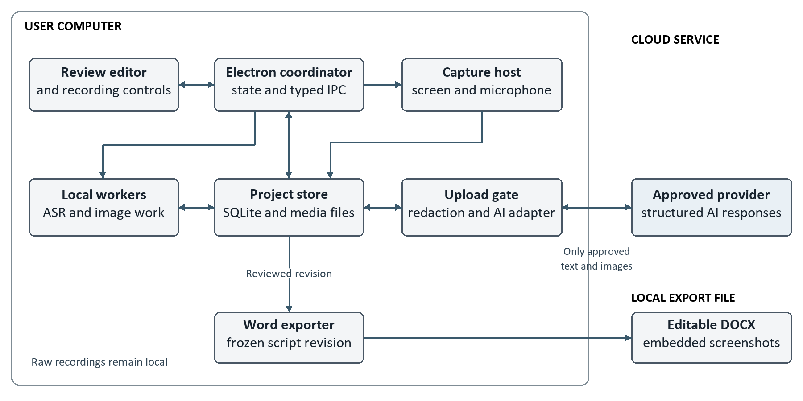
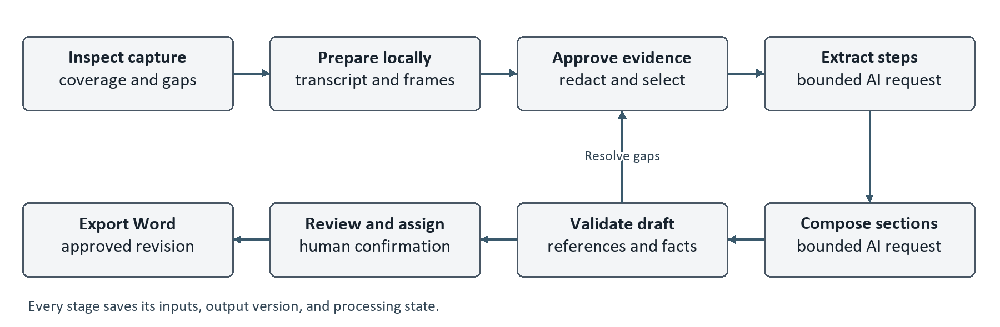

> Historical design/review baseline. The [focused product amendment](publication-audit.md) supersedes references to the removed Copilot, terminal and builder features.

# Webinar Script Recorder High Level Design

Version 0.1 | 25 October 2026 | Proposed architecture

Owners: nDimensions.AI and CharanTheAiGuy

## 1 Recommendation and scope

Build a local-first Electron desktop application with a staged processing pipeline. Save the complete rehearsal on the computer, transcribe locally, select and redact relevant screen evidence, and use a replaceable multimodal AI adapter to draft the script. The editor reviews each step beside its source before exporting an editable Word document.

Use the existing React and TypeScript application as the foundation. Add transactional project storage, durable processing jobs, explicit evidence references, a script editor, and deterministic Word generation. A cloud application backend, vector database, message broker, and meeting bot are unnecessary for the first single-editor release.

The confirmed data policy keeps recordings local and permits selected screenshots and transcript passages to reach an approved cloud AI service. Start with local Whisper transcription and a Gemini multimodal API adapter. Pin exact model identifiers and commercial terms after evaluation; quality and price have not been measured for this project. Fully local generation remains an alternative for stricter deployments.

Gemini is the first integration candidate because its multimodal and structured-output interfaces fit the pipeline. This does not establish it as the most accurate or least expensive provider; evaluate alternatives against the same evidence set.

The confirmed workflow is one narrator rehearsing a webinar, followed by assignment of the final script to three or four presenters. Word with embedded screenshots is the primary output. Windows 11, English, one selected display, and 30-to-60-minute sessions remain proposed MVP boundaries from BRD v0.1. Multiple-speaker recognition and live broadcasting remain outside the first release.

This HLD recommends the architecture and defines interfaces, data ownership, failure behavior, and delivery gates. It does not implement the webinar features or replace the BRD's acceptance criteria.

## 2 Design priorities

- Preserve what actually happened, including unsuccessful attempts and missing evidence.
- Make screenshot and transcript corrections fast enough to reduce total preparation time.
- Keep recording dependable when inference, networking, or the editor fails.
- Keep source media and edits durable; regenerate only affected work.
- Expose processing usage, privacy boundaries, and unresolved technical details.

The key principle is that the recording and approved user edits are authoritative. AI output is a proposed interpretation. A valid evidence reference proves where a statement came from, but does not by itself prove that the statement is correct.

<!-- pagebreak -->

## 3 Solution options

These assessments are engineering judgments based on the requirements and inspected code, not results from a product benchmark.

| Option | Advantages | Limitations and decision |
| --- | --- | --- |
| A Whole video to a multimodal model | Fastest prototype; combines speech and visuals; little custom segmentation. | Whole-session uploads conflict with the confirmed local-recording policy. Excluded from the MVP; any video benchmark needs separate authorization. |
| B Local capture and evidence preparation with cloud drafting | Reuses the application; exact local image selection; controlled uploads; resumable stages and targeted corrections. | More orchestration and evidence logic to build. Recommended MVP; selected-evidence cloud processing is confirmed. |
| C Entirely local inference | No rehearsal content leaves the device; can operate offline after models are installed. | Model size, hardware variability, and technical-image accuracy require separate evaluation. Keep the same interfaces; use when privacy requires it. |
| D Browser recorder and hosted processing service | Central administration and future shared editing. | Adds upload, hosting, identity, retention, and browser capture constraints; discards much existing desktop integration. Defer until shared workflows justify it. |

Option B best matches the current priorities: source-backed accuracy, reuse of the existing recorder, and low operational complexity for one editor. Compare provider models using identical selected evidence. Choose C for deployments that forbid cloud processing and reassess hardware and latency targets. Reconsider A only if the recording policy changes and a benchmark justifies it.

## 4 Supporting technology choices

| Concern | Recommended choice | Reason and alternative |
| --- | --- | --- |
| Desktop | Existing Electron, React, TypeScript | Avoid a native-app rewrite; retain capture and window management. |
| State and history | SQLite with one writer; media as files | Transactions for edits, jobs, and revisions. Plain JSON remains a legacy import format. |
| Local processing | Restartable utility processes | Separate ASR and image work from capture and UI; verify native module stability. |
| Generation | Direct provider adapter with schema validation | Bounded inputs, usage accounting, and no general-purpose agent tools. |
| Word export | TypeScript docx library | Structured .docx generation with embedded images; no installed Word required at runtime. |

SQLite driver compatibility with the pinned Electron runtime is a Phase 0 gate. Prefer a supported bundled binding if available; otherwise pin and rebuild a native driver for each shipped architecture. Avoid choosing a driver solely from the system Node version.

<!-- pagebreak -->

## 5 System architecture

Figure 1. Local source media stays on the device. Only approved evidence crosses the network boundary. Diagram source: diagrams/hld-system.mmd.

| Component | Responsibility |
| --- | --- |
| Review renderer | Project setup, recording controls, source playback, script edits, assignment, and approval. Uses narrow typed IPC. |
| Main process coordinator | Validates commands, owns state transitions and credentials, schedules jobs, and authorizes filesystem and network access. |
| Capture host and media writer | Own screen and microphone streams, record segments, persist timestamps, and report capture health. |
| Local processing workers | Transcription, frame analysis, OCR assistance, redaction derivatives, and Word generation. Heavy work runs outside the UI. |
| Project store | SQLite metadata, revision history, job checkpoints, and an immutable asset directory. |
| AI gateway adapter | Builds bounded requests from approved evidence, enforces budget reservations, validates responses, and records remote file lifecycle. |

The coordinator is the only logical writer of project state. Capture I/O uses a dedicated writer to prevent slow processing from stalling recording. Worker process separation contains failures; it is not an OS security sandbox by itself. Privileged operations remain explicitly controlled.

The pilot uses user-supplied provider credentials protected by the operating system. Do not embed an nDimensions.AI shared API secret in the desktop binary. A managed credential and billing service is a later deployment option, not part of this MVP.

<!-- pagebreak -->

## 6 Recording and time alignment

The capture lifecycle is Idle, Preflight, Recording, Paused, Finalizing, then Captured or Incomplete. Starting requires a valid selected screen, audible microphone preview, writable storage, and enough free space. Loss of a stream produces a persistent visible warning and a timestamped gap; it never silently switches to another microphone or display.

Use a session monotonic clock for alignment. Each source stores its media timestamp, mapping to session time, segment identifier, and discontinuities. Cross-process monotonic clocks must be calibrated through a handshake and periodic checkpoints; wall-clock time is for display and audit only. Reconnects create new mappings. Clock adjustments must not reorder evidence.

Keep recording time, media-local time, and planned webinar time distinct. Pauses close an active capture interval; resume creates another. The player maps the continuous session timeline to the correct media segment and shows paused or missing intervals. The live running order is an editable estimate, never copied directly from rehearsal timestamps.

Proposed starting capture profile: 1080p video at 15 fps with a 4 Mbps target, plus higher-resolution stills from the selected source where practical. Retain source dimensions and crop coordinates. Native-resolution stills require access to the original track before any encoder downscaling. Benchmark 1440p and 4K screens; do not claim that upscaling 720p recovers code text.

## 7 Recoverable media storage

Target independently decodable segments of approximately 30 seconds, committed only after finalization and a read/decode check. Rotate recorder instances on the same source stream with a short measured overlap, record actual start times, and remove overlap logically through timeline metadata. Verify that rotation does not drop frames or clip speech. Pause and stop finalize current segments.

MediaRecorder timeslice events alone do not provide independent playable files. The W3C specification permits individual blobs to be unplayable. Segment rotation therefore requires a real prototype and fault testing; if it cannot meet continuity and CPU targets, replace this component with a proven native capture/muxing implementation. [S2]

Write temporary assets, flush them, then atomically rename them and commit their hashes and manifest entries. A crash can lose the current unsealed segment; the proposed recovery target is no more than 30 seconds plus bounded finalization overlap. Earlier sealed segments must remain usable. This is a target to test, not a claim of zero data loss.

<!-- pagebreak -->

## 8 Processing pipeline

Figure 2. Local preparation precedes network requests. Validation and human review control promotion to an approved script. Diagram source: diagrams/hld-pipeline.mmd.

| Stage | Input and durable output |
| --- | --- |
| 1 Inspect capture | Media manifests and health events become a coverage report and explicit gaps. |
| 2 Transcribe | Audio becomes timestamped transcript spans with model version and source offsets. Preserve the original and corrected text separately. |
| 3 Find candidate scenes | Screen changes, app events, markers, and narration boundaries become candidate frames and intervals. |
| 4 Prepare evidence | Deduplicate, crop, redact, and review selected frames and transcript passages; store approved derivatives and an upload manifest. |
| 5 Extract demonstrated steps | Send bounded evidence packets; receive proposed actions, outcomes, evidence references, conflicts, and take groups. |
| 6 Compose the script | Turn verified step proposals into spoken lines, demonstration instructions, producer notes, and proposed handoffs. |
| 7 Validate and review | Validate references and timing, inspect critical details, resolve flags, and confirm presenter assignments. |
| 8 Export | Freeze a script revision and render Word from its structured content and approved image derivatives. |

Run only light capture and health work during rehearsal. After recording, start with one local ASR worker and at most two concurrent AI requests. All limits are configurable and measured. Avoid multiplying CPU-heavy workers merely because cores are available.

The confirmed route sends selected images and text only. Raw video, audio, and clips remain local. A video benchmark would require a separately authorized change to this policy. Local transcription failure must not silently trigger an audio upload.

<!-- pagebreak -->

## 9 Evidence selection and factual accuracy

Scan a low-resolution proxy at about 2 fps for scene changes, combine those candidates with app switches and markers, then inspect denser frames around candidate steps. Use narration windows with adjustable lead and lag because a presenter may explain an action before or after performing it. Do not select only the nearest timestamp.

Rank frames using stability, text readability, coverage of the relevant region, and distinctness from already-selected frames. Preserve before-and-after states when both explain the step. For each proposed step, initially consider two to four images and allow bounded retrieval of additional local frames. Candidate limits control requests, not coverage: omitted evidence must remain accessible locally.

Use 60-to-120-second transcript windows with approximately 10 seconds of contextual overlap as a starting point. Reconcile duplicate steps by evidence intervals and identifiers. Produce a whole-session outline from compact section summaries, then compose sections with their source evidence and neighboring transition context. Check for missing required steps after merging sections.

OCR provides searchable hints and highlights likely code regions. Exact commands, filenames, numbers, and outputs require visible source verification or user-supplied text. The existing recorded terminal can supply exact text only for its own sessions; it cannot recover commands from an unrelated VS Code terminal.

## 10 Trust and review rules

- Store factual statements as observed, narrated, user-supplied, or editorial. An observed outcome needs supporting visual or terminal evidence; spoken intent alone is insufficient.
- Label suggested transitions and introductions as editorial additions. Never fabricate missing screenshots, successful output, or a completed action.
- Keep failed attempts and retakes in separate take groups. Choosing the final take is reversible and cannot erase source material.
- Validate every returned ID, interval, asset hash, crop, and assigned presenter against the project. Reject nonexistent references even when JSON is syntactically valid.
- Raise reasoned flags for contradictions, illegible text, missing audio, uncertain takes, and unassigned sections. A model confidence score is not an accuracy guarantee.

Schema validation prevents malformed output, but cannot establish semantic correctness; provider guidance makes the same distinction. [S4] The reviewer resolves critical flags and verifies technical details before the script can become Ready.

<!-- pagebreak -->

## 11 Project data and versioning

Store each project under an application-owned local directory. Use SQLite for metadata and revisions; keep large audio, video, and image assets in files referenced by content hashes. Use local disk, a single writer, foreign keys, schema migrations, and durable transactions. SQLite WAL is suitable for concurrent readers on one machine, not an active database on a network share. [S6]

| Entity | Essential data and relationships |
| --- | --- |
| Project and Presenter | Title, audience, objective, target duration, privacy policy, and presenter IDs. |
| Recording and Segment | Capture profile, session clock mappings, segment spans, source dimensions, gaps, path, hash, and sealing status. |
| TranscriptSpan | Recording and segment IDs, start/end, original text, corrected text, source version, and review flags. |
| EvidenceAsset | Frame time or terminal interval, raw hash, crop, derivative hash, redaction version, and upload eligibility. |
| Step and TakeGroup | Order, action, outcome, provenance category, transcript references, image references, and alternative takes. |
| ScriptRevision and Section | Immutable revision ID, parent revision, structured content, assignments, estimated durations, and editor changes. |
| ReviewDecision and Export | Flag resolution, reviewer, approved revision hash, output hash, template version, and timestamp. |
| Job and ProviderRequest | Stage, input hash, state, lease, attempts, usage, reserved cost, remote IDs, and deletion status. |

Raw assets are immutable within the project; corrected transcripts and redacted images are versioned derivatives. An explicit project deletion removes them under the retention policy. Editing a transcript invalidates dependent evidence packets and step proposals. Changing a presenter invalidates assignments, timing, and export, but does not rerun transcription.

A regeneration creates a proposed revision. Use the user's current revision as the comparison base and require an explicit merge for edited fields. Never overwrite accepted text with a late model response. Optimistic revision checks reject stale UI saves. Approval is tied to the exact revision hash and is invalidated by content, image, or assignment changes.

For backup, use a consistent SQLite backup plus its referenced asset manifest; copying an active database file alone is insufficient. Restore verifies hashes and schema version before permitting edits. Jobs for deleted or superseded versions cannot publish results.

<!-- pagebreak -->

## 12 Interfaces and job execution

Expose small typed commands through the existing preload bridge. Every command validates project access, arguments, lifecycle state, and expected revision in the main process. Asset reads use project-scoped opaque IDs, not renderer-supplied absolute paths. Providers never receive arbitrary filesystem access.

| Interface | Contract |
| --- | --- |
| Capture start pause resume stop | Project ID and validated source settings; returns capture state and clock metadata. |
| Processing run retry cancel | Project and input revision; returns durable job ID and stage progress. |
| Evidence inspect replace redact | Evidence ID, approved crop/mask operations, and expected revision. |
| Script save propose regeneration approve | Structured edits or section ID; revision checked before commit. |
| Export Word | Frozen revision ID, template ID, draft/ready state, and destination selected by the user. |
| Model adapter | Evidence packet and bounded output schema; returns result, model identity, usage, request ID, and typed errors. |

A model adapter advertises supported media types, schema features, size limits, usage reporting, remote deletion, and timeout behavior. The initial Gemini adapter uses supported structured outputs; all responses pass the same local schema and evidence checks. A future local adapter implements the same contract without network calls. [S3, S4]

A job key combines project ID, stage, input hashes, privacy-policy version, model version, and prompt/schema version. Reuse a completed result only when all inputs match. States are Queued, Running, WaitingForNetwork, WaitingForReview, Succeeded, Failed, Cancelled, and Superseded. Recover abandoned leases after a restart and resume from the last committed stage.

Commit outputs only after validating the current revision and job lease. Retry transient errors with bounded exponential backoff; do not retry invalid credentials or deterministic schema failures indefinitely. A timeout may have incurred a provider charge: reserve budget for uncertain requests and do not assume exactly-once external execution. Cancel prevents later publication even if a remote request cannot be stopped.

Keep local filesystem export as the final application-controlled side effect. Generation must not execute code from the rehearsal, open URLs named by the model, install skills, or run shell commands. The current Copilot analysis path can remain a legacy feature; it is not the production webinar orchestration layer.

<!-- pagebreak -->

## 13 Review experience and Word generation

Use a three-area editor: source playback and transcript, the section/step script, and evidence plus review issues. Selecting an image or sentence opens its source interval. Provide nearby-frame selection, crop preview, take selection, assignment, and section-level regeneration. Show original narration beside rewritten speech when resolving meaning changes.

Estimate speaking duration from word count using an editable presenter rate. Represent action and wait intervals separately; allow speech and demonstration to overlap so duration is not double-counted. The running order remains a planning aid until validated through rehearsal. Show overflow against the webinar target and suggest optional trims without deleting required steps.

Generate Word from a typed ScriptDocument representation, not AI-generated HTML or a screenshot of the editor. Use the TypeScript docx library for headings, editable paragraphs, tables, and embedded image bytes. Its project provides Node/TypeScript document generation and image examples. [S7]

The output includes context, a running order, presenter sections, Say/Do/Show content, producer notes, handoffs, and an evidence appendix. Each image has a caption, recording ID, timestamp, and alternative text. Source jump links may open the desktop project when available; offline timestamps remain useful on another computer without the application.

Apply an export profile that checks image sizes, caption placement, page breaks, and code legibility. Use cropped detail plus an optional context frame when a whole editor screen is unreadable on paper. Keep commands as verified editable text. All image data is embedded; no remote image dependency is permitted.

Draft exports prominently retain unresolved items. Ready exports require no blocking flags, confirmed assignments, verified critical facts, and approval of the exact revision. Write to a temporary file and rename after validation. Use a distinct versioned filename unless the user explicitly chooses to replace an existing export.

## 14 Export validation

Check the OOXML package, embedded image count, text content, references, and output hash automatically. During release qualification, open exported documents in Microsoft Word and render representative fixtures to inspect every page. End users do not need Word installed to generate a .docx; this development-time render workflow is not a production dependency.

External edits made in Word do not sync back in MVP. Preserve earlier exports and clearly identify the application revision used to produce each one.

<!-- pagebreak -->

## 15 Privacy and execution boundaries

The user confirmed selected-evidence cloud processing on 25 October 2026: recordings stay local; only selected, reviewed transcript passages and screenshot derivatives may reach an approved provider. Recording, playback, local transcription, manual editing, and export remain available offline. Offline automatic drafting requires a separately qualified local model.

Before any request, create an upload manifest of permitted derivatives and text spans. Apply exclusions to every outgoing representation, including OCR text, terminal excerpts, filenames, and logs. Redact before upload, not only during export. Keep raw assets accessible only locally and disclose that they may still contain sensitive material.

Use sandboxed renderers, context isolation, no renderer Node integration, validated IPC senders, restrictive navigation, and a content security policy. Treat transcript, OCR, code comments, and model output as untrusted data. Prompts instruct models to interpret this material as evidence; actual protection comes from the absence of executable tools and from application validation. [S1]

Protect provider keys through Electron safeStorage backed by Windows facilities and keep them out of renderer messages and logs. This does not encrypt all recordings or defend against every process running as the same user. Use restrictive local permissions and disclose that full media-at-rest protection depends on the selected storage/encryption policy. [S8]

Prefer request-scoped image payloads when supported. If remote file uploads are used, persist remote IDs and queue deletion on success, failure, cancellation, and project deletion. Retry failed deletion visibly. Provider file expiration is not equivalent to all provider retention or training policies; verify account-specific terms before sensitive pilots. [S5]

Project deletion first stops capture/jobs and fences late responses, then removes database records and local assets and schedules remote cleanup. Display pending remote deletion explicitly. User-exported Word files and independent backups are outside project deletion. Do not promise secure erasure from SSDs, provider logs, or previously shared documents.

## 16 Distribution and licensing

Retain MIT licensing for nDimensions.AI and CharanTheAiGuy contributions, LICENSE-UPSTREAM, and existing dependency notices. Any added capture engine, SQLite driver, model, codec, or Word library must enter the release inventory. Preserve corresponding-source and relinking requirements where applicable. Do not bypass the existing packaging checks to accelerate a prototype release.

<!-- pagebreak -->

## 17 Capacity and cost model

The following values are planning assumptions for a 30-minute recording, not measurements or price quotations. Benchmark on a named Windows machine with a recorded CPU, RAM, GPU, screen resolution, and network profile.

| Item | Planning calculation |
| --- | --- |
| Video | 4 Mbps times 1,800 seconds divided by 8 is about 900 MB decimal; encoder behavior varies. |
| Audio | 128 kbps for 1,800 seconds is about 29 MB, excluding container overhead. |
| Candidate analysis | 2 fps creates 3,600 analysis points, not necessarily 3,600 stored full-resolution images. |
| Retained evidence | Example: 180 frames averaging 0.5 MB add 90 MB. Final selection depends on content. |
| Working storage | Allow raw assets, derivatives, temporary export, model cache, and backup overhead. A 5 GB free-space preflight floor is provisional and scales with duration/profile. |
| Draft latency | BRD target: reviewable draft within 10 minutes after 30 minutes of rehearsal, including network and queue time, excluding first-time setup. |

Estimate cost as the sum of input text tokens, image/video tokens, output tokens, any hosted transcription, retries, and optional storage multiplied by the selected provider's current rates. Store the rate-card version with each estimate. Measure the actual number and resolution of images sent; image count alone is not a reliable cost estimate.

Before dispatch, reserve a conservative maximum from the session budget using bounded inputs and output limits. Reconcile with returned usage. Keep reservations for requests with unknown outcomes until reconciled or explicitly handled. Do not start another paid call when remaining budget cannot cover its reservation. Provider billing behavior can still require later reconciliation.

Target bounded memory by processing media incrementally, caching thumbnails, and loading full-resolution assets on demand. Never decode the entire 60-minute video into memory. Limit local worker concurrency and apply backpressure to frame analysis; recording health has priority over background enrichment.

Track capture gaps, clock drift, segment sealing latency, decode failures, ASR throughput, frames selected/rejected, stage latency, request usage, retries, review time, correction counts, and export failures. Logs contain identifiers and diagnostics rather than raw transcript or screenshot content by default.

<!-- pagebreak -->

## 18 Reuse and changes to the current project

This assessment is based on source inspection; the application has not been benchmarked for this HLD.

| Existing area | Proposed treatment |
| --- | --- |
| electron/video and electron/audio | Reuse permission and source selection flows; redesign capture profiles, segment sealing, pause/resume, and health reporting. |
| electron/recorder/session-store.ts | Retain legacy session reading; add a new project store and asset manifests. Import through a versioned adapter. |
| electron/narration | Reuse Whisper integration and timestamp handling; run as a durable worker and preserve existing native-runtime workarounds until retested. |
| electron/frames and common/correlation.ts | Reuse image extraction and deduplication utilities; add narration-aware selection, transient-event probing, and semantic coverage checks. |
| electron/sensitive | Reuse applicable scanning and redaction functions; enforce one consistent derivative manifest before uploads and exports. |
| electron/pipeline.ts | Keep legacy behavior for existing sessions; introduce a webinar job graph with failures and review states instead of best-effort completion. |
| electron/describer and skillbuilder | Retain only for legacy skill workflows; add direct provider adapters and script-domain schemas for webinars. |
| src and common/ipc.ts | Extend project setup and recording controls; add review editor, typed commands, and revision-aware updates. |

The current capture profile is 1 fps with a 1280 by 720 ceiling, and frame enrichment can be skipped on failure. Current recorder state exposes idle/recording, not the complete proposed capture lifecycle. These are implementation gaps, not settings that alone deliver the new product.

The existing Copilot describer constrains its custom tool allowlist. The new design should preserve that legacy boundary and avoid expanding it to support webinar generation. Direct model requests are recommended for simpler usage accounting and structured content generation, not because the existing feature is assumed to execute unrestricted tools.

Introduce proposed modules under common/webinar, electron/projects, electron/jobs, electron/evidence, electron/providers, electron/export, and src/webinar. Names are organizational suggestions; no code is created by this HLD. Existing recordings open through a read-only legacy adapter until explicitly imported. Preserve the original directory and mark imported low-resolution or missing evidence honestly.

<!-- pagebreak -->

## 19 Delivery phases and decision records

| Phase | Deliverable and exit gate |
| --- | --- |
| 0 Feasibility spikes | Compare model candidates on identical selected evidence from a 5-to-10-minute demo; validate native text capture, segment recovery, ASR speed, SQLite binding, and Word export. Stop or revise if evidence cannot be retained reliably. |
| 1 Capture and projects | Durable capture, clock mapping, preflight, pause/resume, source playback, and imported legacy sessions. Pass disconnect, storage, sleep, and crash scenarios. |
| 2 Evidence and drafting | Versioned transcript, candidate selection, redaction manifest, bounded provider adapter, job recovery, and source-linked draft. Pass invalid-reference and conflicting-take tests. |
| 3 Review and delivery | Edit/compare workflow, presenter assignments, timing, approval, and Word export. Preserve edits during regeneration and verify offline image embedding. |
| 4 Pilot | Evaluate at least five real rehearsals against the BRD, including a 60-minute session. Report each case, median, worst case, costs, and human review effort. |

ADR01 selects a local-first desktop application; reopen if multi-user collaboration becomes central. ADR02 selects staged evidence preparation under the confirmed local-recording policy; whole-video cloud processing requires a policy change. ADR03 selects SQLite plus immutable assets; avoid a distributed database before a server is needed.

ADR04 separates observed evidence, narrated claims, and editorial additions. ADR05 uses deterministic Word generation from a frozen script revision. ADR06 keeps AI adapters replaceable and pins model/prompt/schema versions. ADR07 uses durable jobs with revision fencing instead of an always-running conversational agent. These decisions are proposed for the MVP.

## 20 Decisions still required

Confirm the approved provider and account-specific data terms, per-rehearsal budget, target hardware, maximum duration, and Windows architecture coverage. Select an exact model and SQLite binding after Phase 0. Agree the Word template and pilot approvers. English and one-display scope remain provisional; selected-evidence cloud permission is confirmed.

Do not add Kubernetes, a vector store, collaborative CRDT editing, speaker diarization, or a new web backend to the first implementation without a requirement that justifies their maintenance cost. Future collaboration can introduce authenticated project synchronization and server job execution while retaining the evidence and revision contracts.

No delivery date is committed here. Phase 0 results should inform effort estimates before scheduling the remaining implementation.

<!-- pagebreak -->

## 21 Requirements and validation traceability

| BRD coverage | Design and verification |
| --- | --- |
| BR01 to BR04 | Project setup and capture lifecycle; test source selection, pause/resume, disk failure, markers, and visible gaps. |
| BR05 to BR08 | Timestamped spans, stage extraction, provenance categories, and take groups; evaluate technical terms, missing speech, and retakes. |
| BR09 and BR10 | Frame selection and immutable derivatives; check relevant state, original timestamp, crop fidelity, readability, and no invented images. |
| BR11 | Separate presenter assignment and live schedule; check handoffs, unassigned sections, and overlapping speech/action timing. |
| BR12 and BR13 | Evidence review, optimistic revisions, proposed regeneration; test stale saves, late results, and restart recovery. |
| BR14 to BR16 | Structured Word export, approval bound to revision, draft flags; check embedded media, editability, versioned output, and optional presenter extracts. |
| NFR01 and NFR02 | Worker isolation, bounded memory, sealed media, durable jobs, and backups; measure performance and inject failures. |
| NFR03 to NFR05 | Upload manifest, protected credentials, deletion ledger, and budget reservations; inspect outbound payloads and simulate retries/timeouts. |

Use identical selected evidence and an agreed reference script to compare model candidates. Keep source recordings local. Have the webinar lead and another reviewer label required steps, correct takes, critical facts, and usable image moments before scoring. Compare drafts before correction and final scripts after review; do not hide review effort inside an accuracy score.

Retain the BRD targets: at least 95% required-step coverage and screenshot alignment in each draft, at least 60% median hands-on time reduction, every critical step present or flagged, and no unresolved critical factual error in a Ready script. Timing drift target is at most one second at checkpoints through 60 minutes. Prove recoverability separately from transcript quality.

Adversarial fixtures include instructions displayed inside a terminal or webpage, hallucinated evidence IDs, code differing by one character, duplicate or skipped sections at chunk boundaries, stale redaction versions, a failed demo followed by success, and a timeout after provider billing. Verify that no content in those fixtures can trigger command execution or unauthorized uploads.

An MVP release requires both the measured business result and technical fault tests. A successful single demonstration is insufficient evidence for general accuracy or capture reliability.

<!-- pagebreak -->

## 22 Sources and design evidence

Source code inspected on 25 October 2026: package.json; common/types.ts; common/frames.ts; common/narration.ts; electron/recorder/session-store.ts; electron/video/recorder.ts; electron/video/capture-preload.cjs; electron/narration/whisper.ts; electron/narration/transcribe.ts; electron/pipeline.ts; electron/describer/describer.ts; and electron/window.ts. Business baseline: docs/business-requirements.md version 0.1.

The repository confirms capture defaults, local source storage, timestamped transcription, best-effort processing, and the Copilot tool allowlist. Recommendations such as SQLite, segmented media, direct API drafting, and Word generation are proposed additions.

- **S1 Electron capture and security.** [desktopCapturer](https://www.electronjs.org/docs/latest/api/desktop-capturer) and [security guidance](https://www.electronjs.org/docs/latest/tutorial/security) support the desktop capture and restricted-renderer design.
- **S2 W3C MediaStream Recording.** [Recording specification](https://www.w3.org/TR/mediastream-recording/) distinguishes returned blobs from a complete playable recording. This motivates explicit segment validation.
- **S3 Gemini video understanding.** [Video processing documentation](https://ai.google.dev/gemini-api/docs/video-understanding) describes multimodal video input, timestamps, and configurable sampling. Default sampling can miss fast actions, so the proposed route supplies selected frames directly.
- **S4 Gemini structured outputs.** [Structured output documentation](https://ai.google.dev/gemini-api/docs/structured-output) describes schema-based responses and the need to validate semantic values locally.
- **S5 Gemini file lifecycle.** [Files API documentation](https://ai.google.dev/gemini-api/docs/files) documents file deletion and automatic expiration. These controls do not establish account-specific processing or retention terms.
- **S6 SQLite persistence.** [Write-ahead logging documentation](https://www.sqlite.org/wal.html) describes concurrency and the requirement that participating processes use the same host rather than a network filesystem.
- **S7 Word generation.** [docx project](https://github.com/dolanmiu/docx) provides JavaScript/TypeScript document generation and image examples.
- **S8 Credentials and workers.** [Electron safeStorage](https://www.electronjs.org/docs/latest/api/safe-storage) and [utilityProcess](https://www.electronjs.org/docs/latest/api/utility-process) document relevant platform facilities.
- **S9 Local transcription.** [Transformers.js pipelines](https://huggingface.co/docs/transformers.js/api/pipelines) documents automatic speech recognition with optional timestamped chunks; the existing integration must still be evaluated on the team's recordings.

External documentation was checked on 25 October 2026. Recheck model availability, limits, pricing, data terms, native runtime compatibility, and distribution notices before implementation. None of these sources proves this application's end-to-end quality; that evidence comes from the pilot.
