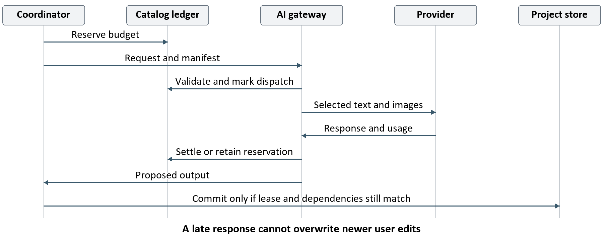

> Historical design/review baseline. The [focused product amendment](publication-audit.md) supersedes references to the removed Copilot, terminal and builder features.

# Webinar Script Recorder Low Level Design

Version 0.1 | 25 October 2026 | Implementation design

Owners: nDimensions.AI and CharanTheAiGuy

## 1 Baseline and implementation contract

This LLD implements the HLD v0.1 approved by the user on 25 October 2026. Build on the existing Electron, React, and TypeScript recorder. Keep recordings and transcription local; send only selected evidence to an approved cloud AI service. Produce a source-linked draft, divide it among three or four presenters, and export an editable Word document with real screenshots.

The HLD is the architecture baseline. This document supplies component contracts, database structure, state transitions, algorithms, error handling, and implementation gates. It does not claim that the proposed application has been implemented or benchmarked. The HLD file retains its original publication status; this document records the subsequent approval.

Implement Windows 11, English, one display, and 30-to-60-minute rehearsals as the initial qualification scope. These were provisional HLD boundaries and remain planning assumptions. Exact model, SQLite driver, capture overlap, and performance thresholds must pass the Phase 0 experiments before production dependencies are pinned.

The companion files are design references, outside the application build: lld/project-schema.sql, lld/catalog-schema.sql, and lld/contracts.ts. The SQL is executable reference DDL, not an installed migration. The TypeScript defines transport and domain shapes; production code must add strict runtime validation and the cross-row invariants described here.

## 2 Nonnegotiable invariants

- A raw recording, original transcript, sealed frame, or accepted script revision is never overwritten by regeneration.
- Every factual script claim retains source references or is identified as user-supplied; editorial additions remain labeled.
- Raw audio, video, and clips cannot enter a webinar provider request. A provider error never enables a broader upload policy.
- A stale job, revoked manifest, deleted project, or expired lease cannot publish a result or start another network request.
- A Ready export requires approval of its exact content and evidence dependencies. Draft exports visibly preserve unresolved issues.
- Project deletion can remove local data while remote cleanup or billing reconciliation remains pending and visible.

Read this document in sequence for implementation. Sections 3–5 define storage and components; 6–10 define capture and IPC; 11–16 define processing; 17–20 define review, export, and recovery; 21–22 define delivery and verification.

<!-- pagebreak -->

## 3 Modules and process ownership

Keep the legacy skill workflow behind its existing interfaces. Add the webinar domain without changing the meaning of legacy session.json, events.jsonl, or bundle.json. A separate window and preload API prevent the new recorder from inheriting broad legacy renderer privileges.

| Proposed module | Main responsibility and boundary |
| --- | --- |
| common/webinar | Domain types, strict Zod schemas, errors, hash rules, IPC constants. No filesystem or provider SDK imports. |
| electron/projects | ProjectService, AssetStore, StoreWorker, migrations, backups, legacy import. |
| electron/capture | CaptureCoordinator, ClockMapper, SegmentWriter, bounded decoder host. Reuse source enumeration. |
| electron/jobs | Durable scheduler, worker pool, leases, dependencies, cancellation and recovery. |
| electron/evidence | TranscriptService, SceneSelector, EvidenceService, redaction derivatives, ManifestService. |
| electron/providers | ProviderGateway, GeminiAdapter, usage accounting, credential access and remote cleanup. |
| electron/scripts | StepReconciler, ScriptService, RevisionMerger, ReviewValidator, DurationEstimator. |
| electron/export | WordRenderer, ExportValidator and publication workflow. No AI calls. |
| src/webinar | ProjectLibrary, Setup, CaptureHUD, ReviewWorkspace, EvidenceInspector and ExportDialog. |

The Electron main coordinator authorizes commands and owns logical state. A single StoreWorker owns SQLite connections and serialized database mutations so synchronous database work does not block the main event loop. Only registered repository operations cross that boundary; renderers and processors cannot submit arbitrary SQL.

A hidden capture renderer owns browser media APIs. A dedicated writer receives bounded media chunks and persists files. Separate utility workers handle ASR and image work. Chromium decoding uses a dedicated decoder renderer where browser codecs are required; moving decodeAudioFile unchanged into a utility process would not work because it creates BrowserWindow instances.

Default to one CPU-heavy processing task and at most two provider calls. Reserve the writer for capture. ProviderGateway runs outside renderer code and obtains credentials only for dispatch. Utility-process separation is fault isolation, not a security sandbox. New webinar windows use contextIsolation, nodeIntegration false, and sandbox true; qualify their preload and media features in Phase 0.

<!-- pagebreak -->

## 4 Storage layout and transaction rules

Use an application-owned webinar directory beneath userData. Place catalog.sqlite and encrypted credential references at its root. Each projects/<projectId> directory contains project.sqlite, assets/<hash-prefix>/<assetId>.<extension>, staging, and exports. Names are generated internally; project titles never become paths. The catalog stores lifecycle, budgets, remote handles, and deletion tasks without source text or screenshots.

Use main-generated UUIDs for identifiers and lowercase SHA-256 for content hashes. Store source time as nonnegative integer microseconds, live estimates as integer milliseconds in persistence where needed, and audit dates as UTC ISO strings. Validate every JavaScript numeric timestamp as a safe integer. Do not mix media offsets, session offsets, wall-clock dates, and webinar schedule positions.

Initialize each database with foreign_keys ON, WAL, synchronous FULL, and a bounded busy timeout. Acquire an application single-instance lock before opening writable projects. Reject active databases on network shares or known synchronization folders; an exported backup may be copied there. Database durability still depends on the filesystem and hardware honoring flushes. [L3]

Use short BEGIN IMMEDIATE transactions for compare-and-swap mutations. Validate expected revision, insert the new revision, change the head, record the idempotency result, and append the event in one commit. Do not keep a transaction open while awaiting capture, inference, network, filesystem decoding, or a user dialog. Retry database-busy only within a bounded local timeout.

Sealing an asset is a recoverable two-resource operation: write to staging on the same volume, flush and close, validate/decode, compute its hash, rename into assets, then commit metadata. A file renamed before a crash but absent from the database is an orphan; reconcile it through its sealed sidecar manifest. A database reference to a missing file becomes a blocking integrity issue. Never describe file rename and database commit as one atomic operation.

Canonical hash input uses UTF-8 JSON, recursively sorted object keys, ordered arrays, finite safe integers for counters/times, LF line endings, and no undefined fields. Reject duplicate JSON keys on untrusted model decoding where the parser permits detection. Hash the canonical document and dependency manifest separately; a DOCX ZIP byte hash identifies one export, not a promise of byte-identical regeneration.

<!-- pagebreak -->

## 5 Persistence entities and constraints

The complete field declarations and basic constraints are in the two SQL references. A project database contains one project row. References inside it cannot resolve to another project's assets. Application validation enforces semantic constraints that a foreign key cannot express.

| Entity group | Persistence and additional invariants |
| --- | --- |
| Project and presenters | Context, head revision, state/source/policy versions; deactivate presenters rather than deleting referenced identities. Snapshots retain historical names and speaking rates. |
| Recordings and clock maps | Lifecycle, capture epoch and immutable clock anchors. Map identity must match a segment's recording and track. |
| Segments and intervals | Only sealed segments enter segments. Trimmed playback ranges cannot overlap within a track. Gaps and pauses remain explicit. |
| Assets and evidence | Hash, generated relative path, dimensions, source timestamp and quality report. Validate kind compatibility and same-project ancestry. |
| Transcript and derivatives | Original spans plus append-only edits; image masks/crops and redacted text are new derivatives, never in-place changes. |
| Manifests | Exact text/image IDs, hashes, provider profile, source and policy versions. Revocation prevents future dispatch. |
| Steps and take groups | Stable logical ID plus immutable version. Validate every nested reference and selected take membership. |
| Script and approval | Immutable document snapshot, parent/base IDs, review flags, decisions and dependency-bound approval. |
| Jobs and events | Unique input key, dependency edges, lease, attempt, output, operation receipt and monotonically increasing event sequence. |
| Catalog ledger | Project generation, reservations, charges, remote IDs and deletion progress survive project-directory removal. |

Reference DDL uses JSON columns for bounded document snapshots and structured details. Validate JSON with versioned Zod schemas before writes and after reads; json_valid alone does not establish shape or ownership. Prevent cycles in job dependencies, derivative ancestry, take references, and revision ancestry in coordinator operations.

Index segments by recording, track, and start time; runnable jobs by state and delay; budget requests by project and accounting state. Page transcript, evidence, and revision history rather than loading all content into the UI. Retain committed history for the MVP; garbage collection deletes only unreferenced staging/orphan files after recovery, never evidence pinned by a revision or pending export.

<!-- pagebreak -->

## 6 IPC transport and validation

Expose window.webinar through a narrow contextBridge preload. Each method maps to a fixed channel, never an arbitrary channel supplied by the page. Validate the sender's webContents, main frame, application origin, and currently bound project. Deny subframes, external navigation, and unexpected windows. Do not return raw IpcRendererEvent objects. [L1]

Mutation envelopes contain protocolVersion, requestId, projectId, expectedStateVersion, and payload. Successful replies return stateVersion and a typed value. Failures return a stable error code, safe message, retryability and correlationId; they never serialize native stacks, keys, raw transcripts or filesystem paths to a toast.

The state version changes for control/content mutations, not every progress tick. Source version changes for transcript edits or evidence selection inputs. Policy version changes for upload/redaction policy. Script saves additionally compare the baseRevisionId. Jobs record the specific dependency versions they consume; unrelated UI changes do not invalidate transcription.

Persist completed mutation receipts by requestId, method and payload hash. An identical retry returns the original result; reuse of an ID with different content fails VALIDATION. A long operation first commits its intent and job ID, then runs asynchronously. Recovery completes or fails that intent. Never blindly replay capture.start merely because a reply was lost.

| Input class | Initial application limit |
| --- | --- |
| Ordinary command | 1 MiB serialized payload; no image bytes or media blobs. |
| Script save | 5 MiB, 200 sections, 2,000 blocks; reject oversized edits with a clear message. |
| Text fields | Title 200 characters; context field 8,000; block 12,000; total script 200,000. |
| Evidence and paging | 200 records per page; 200 masks per image; finite integer pixel coordinates. |
| Capture port | 1 MiB message fragments; 16 MiB outstanding credit per track; bounded queue. |

These are configurable application limits, not provider limits or measured hardware capacities. Zod schemas are strict, reject unknown keys, and enforce depth/count limits. Source and microphone tokens are short-lived handles created by main after enumeration, bound to the capture window and project; they are not arbitrary renderer-provided device paths.

<!-- pagebreak -->

## 7 Command and event catalogue

The companion contracts.ts specifies full input/output shapes for mutations. Read operations return bounded snapshots and cursor pages. Project creation/listing and provider setup are application-scoped, use separate schemas, and do not require a nonexistent project ID.

| Command family | Required precondition and effect |
| --- | --- |
| project create update open | Validate context and project generation. Create directories/catalog entries recoverably; opening returns snapshot plus last event sequence. |
| capture start pause resume stop | Enforce lifecycle and capture epoch. Return the committed transition immediately; completion arrives as capture.changed. |
| marker add | Main stamps session time. Capture only the selected display; manual marker persists even if its screenshot fails. |
| transcript correct | Append edit; increment source version; supersede dependent evidence/draft jobs and current approvals. |
| evidence derive and inspect | Validate source ID and pixel bounds; create a worker job or return local asset capability. |
| manifest approve and revoke | Verify exact preview hash; bind approval to policy/provider/source versions. Revoke queued dispatches immediately. |
| jobs run retry cancel | Resolve dependencies server-side, admit budget where relevant, and fence cancelled attempts. Renderer cannot nominate arbitrary input files. |
| script save merge approve | Compare head/base; validate all references and review decisions; return a new immutable revision or conflict. |
| export word | Freeze revision, evidence and template; open main-owned destination dialog; return export job. |
| project delete | Confirm matching project ID; persist catalog tombstone before stopping workers and removing data. |

Event envelopes contain projectId, sequence, stateVersion, kind and safe payload. Sequence numbers are assigned inside the same transaction as durable state. On a missing sequence or reconnect, fetch a fresh snapshot and subscribe after its sequence; do not infer missing mutations from a partial event stream. Progress messages may be transient, rate-limited to five per second, and never increment the content version.

Capture chunks travel on an authenticated MessagePort associated with a capture epoch, separate from ordinary UI IPC. MessagePorts supply transport, not application backpressure or authorization; the writer protocol adds credits, sequence checks, and closure handling. Qualify copy/transfer behavior in the pinned Electron runtime rather than assuming zero-copy transport. [L2]

Keep side-effecting controls disabled during incompatible transitions. A lost renderer can reconnect to the coordinator's current recording. Closing the review window does not stop capture; quitting the application performs the explicit stop/finalize flow.

<!-- pagebreak -->

## 8 Capture state machine

Idle means no active recording. A completed recording remains Captured or Incomplete in the database while the capture controller can return to Idle to create another. A per-project mutex serializes lifecycle commands; a second active recording is rejected BUSY. Every restart/resume establishes a new capture epoch so late chunks from an old stream cannot attach to a new segment.

| Current state and event | Transition and persistent result |
| --- | --- |
| Idle plus start | Preflight; validate screen, audible microphone preview, storage, codec and clock handshake. |
| Preflight succeeds | Start both tracks; enter Recording only after media-start acknowledgments. Persist each actual anchor. |
| Preflight or start fails | Stop acquired tracks. Enter Incomplete if media exists; otherwise remove the empty provisional row, return Idle and retain a diagnostic receipt. |
| Recording plus pause | Set transition pause, stop accepting new intervals, seal both tracks; enter Paused after acknowledgments. |
| Paused plus resume | Revalidate original sources and storage, open new epoch and segments; then Recording. Failed reacquisition stays Paused with a gap flag. |
| Recording or Paused plus stop | Finalizing; drain writer, seal files and inspect coverage; then Captured or Incomplete. |
| Source loss or writer failure | Show persistent warning, record gap, finalize what is usable and pause when possible. Never substitute another device silently. |
| Process crash during capture | On restart recover sealed segments, close open intervals at last known evidence, and mark Incomplete. Start a new recording for further capture. |

Preflight uses max(5 GiB, estimatedRemainingMediaBytes × 2 + temporaryWorkAllowance) as a provisional free-space rule. Distinguish decimal bitrate estimates from binary free-space units. Warn at the larger of 1 GiB or two estimated segment sizes; stop before disk exhaustion at the larger of 256 MiB or one segment size. Thresholds are initial engineering defaults requiring pilot measurement.

Use a one-second health heartbeat and flag a five-second stale heartbeat. A loss of audio does not label the remaining video as a complete rehearsal. Windows sleep, lock, and display changes invoke the same gap/revalidation behavior. Best-effort sleep inhibition may reduce interruptions but cannot replace recovery logic.

<!-- pagebreak -->

## 9 Segment writer and clock mapping

Request native-resolution screen input. Derive the proposed 1080p, 15 fps, 4 Mbps encoded stream separately, and capture native stills before downscaling. Record actual constraints and source dimensions; unsupported native stills produce a visible quality limitation. Select a supported WebM codec using runtime capability checks; MIME support is a preflight gate, not an assumption.

Record screen and microphone tracks separately with independent clock maps. Rotate each recorder into approximately 30-second finalized files. Start the next recorder before stopping the previous one; measure a bounded overlap, initially 250 ms. The overlap and encoded timestamps determine logical trim points. A timeslice blob is only a chunk of its recorder instance, not a standalone segment. [L5]

Writer messages are open, chunk, close and abort. Chunk sequence starts at zero per segment. Fragment large dataavailable blobs, await credit, and acknowledge only after bytes reach the file stream. An acknowledgment is not a durable seal. On close, drain all contiguous sequences, flush, finalize, decode-check and hash before emitting sealed. Missing sequences, extra bytes after close, and old epochs fail explicitly.

The 16 MiB per-track queue is a provisional memory limit. On sustained backpressure, stop/finalize and flag an incomplete interval; dropping chunks would corrupt media. Start a 10-second sealing watchdog. If a segment cannot seal and the next segment approaches its own rotation, stop creating more recorders; bound active instances to two per track. This bounds recovery loss to segment target plus a measured sealing allowance, not an unbounded chain of unfinished files.

ClockMapper pairs renderer monotonic timestamps with main monotonic timestamps using repeated request/reply samples and the lowest round-trip observations. Calibrate at start and every 10 seconds; fit a scale and offset only from valid anchors. Store uncertainty and reject implausible discontinuities rather than adjusting already committed timestamps retroactively.

Map media to session time as sessionAnchorUs + round((mediaUs − mediaAnchorUs) × scale). Do not use arrival time of a blob as its recording time. Retain decoded duration, sample/frame timestamps where available, and explicit uncertainty where browser APIs cannot supply exact anchors. Phase 0 must prove audio/video alignment within the HLD's one-second drift target; otherwise replace capture/muxing while retaining this contract.

<!-- pagebreak -->

## 10 Playback and local asset access

The timeline stores half-open intervals [startUs, endUs). A seek selects the sealed, logically trimmed segment containing session time and applies its inverse clock map. At a pause or missing range, show the labeled interval and offer the next available point; do not pretend there is media there. Overlap trims are metadata and never modify raw bytes.

Synchronize separate audio/video elements to session time. A provisional 100 ms playback drift threshold triggers a corrective seek at a safe boundary; mute or pause a missing track and show its gap. Distinguish playback synchronization from source timestamp accuracy. Prefetch the next segment, retain a bounded buffer, and test seamless boundaries with spoken numbers and screen flashes.

Serve local assets through a registered application protocol using opaque asset IDs and short-lived capability tokens. Bind tokens to the requesting application session, project generation, asset and permitted representation. Store tokens in memory, revoke on project close/deletion, and omit them from logs. The protocol must use the same Electron session/partition as its window. [L4]

Implement GET and HEAD, explicit MIME types, content length, byte ranges and 206/416 responses for media seeking. Reject arbitrary paths, remote URLs, executable content and traversal. Resolve generated paths within the project root and reject symlinks/reparse points that leave it. Use no-store responses for sensitive raw assets. Restrict CSP media-src and img-src to the application protocols and required local resources.

The script preview shows approved derivatives by default. An explicit source inspection can show the raw local frame. Keep raw and redacted views visibly distinct. Source jump links in Word use recording IDs and timestamps as text; optional app links require strict parsing and user navigation, never shell execution.

## 11 Bounded transcription

Decode sealed audio segments plus adjacent overlap into 16 kHz mono PCM in a decoder renderer, then send a bounded window to the ASR utility worker. Use a 30-second core with up to five seconds of context on either side; do not reuse the existing whole-session PCM allocation for 60-minute recordings. A 40-second Float32 window is approximately 2.56 MB before model/runtime overhead.

Whisper returns text and chunk intervals. Clip ownership to core windows, reconcile matching words at overlaps, and preserve boundary uncertainty when alignment is insufficient. Store original spans, model/version and source hashes. Silence heuristics flag suspicious output; do not silently discard a legitimate closing phrase such as “thank you.” Corrections and glossary suggestions create new text versions.

<!-- pagebreak -->

## 12 Scene selection and screenshot quality

SceneSelector runs after capture except for lightweight native-still capture and explicit markers. Scan a low-resolution proxy at approximately 2 fps, combine scene changes with markers, app activation events and transcript boundaries, and probe surrounding encoded frames more densely. Native stills are preferable for code text; an encoded-frame fallback retains its actual resolution and quality flag.

At capture time, retain native stills for markers, stable scene changes and a five-second heartbeat, subject to queue/storage limits. Sample cheap downscaled differences without blocking encoding. If still processing falls behind, skip optional still work with a recorded limitation; never drop mandatory audio/video chunks. Rapid transitions may only exist in encoded video and must be recoverable through local probing.

Use a deterministic candidate score with versioned weights: relevant time coverage, stability, region readability, novelty and marker priority. Normalize scores to comparable ranges and retain the components for diagnostics. Start with equal weights until a labeled pilot tunes them; do not present a heuristic score as calibrated factual confidence.

Group near-duplicates with dHash and time proximity, but never discard a before/after pair solely because global hashes are similar. A one-character terminal change can matter. Compare relevant-region differences or retain both whenever technical text changes or a marker demands it. Keep selection reversible and preserve access to all sealed video.

For each transcript window, select initial images across its scene intervals, capped at 12 images per request and within provider limits. After step extraction, choose two to four explanatory images per step as a starting point. If the packet cannot fit while preserving coverage, split at a scene/narration boundary and track covered/uncovered intervals; never silently truncate.

Evidence records contain recording ID, actual frame time, raw asset ID, selection reason, dimensions and quality flags. A crop is an integer pixel rectangle within the raw frame. Show context plus detail crops when code is unreadable at document width. OCR aids discovery and masking but cannot authorize an exact command or successful outcome on its own.

A model may suggest a missing interval; the coordinator can retrieve local candidates within that project only. Additional source material must pass the same selection/redaction approval flow. Maximum two expansion rounds per packet by default; unresolved coverage becomes a review flag rather than an indefinite AI loop.

<!-- pagebreak -->

## 13 Redaction and upload manifests

EvidenceService creates immutable screenshot derivatives. Apply solid masks in raw pixel coordinates before cropping/resizing, then strip metadata and encode PNG for text-heavy frames or qualified JPEG where appropriate. Validate masks against raw dimensions; compare crop and transformed coordinates. Never rely on blur alone for secrets or attach the original bytes behind a redacted preview.

Text redaction covers transcript passages, glossary/context, filenames, terminal excerpts and editor instructions. Persist exact redacted strings and hashes. Reuse existing scanners as candidate detection; a detection pass is not a guarantee that all sensitive content is removed. Show a batch preview of every outgoing image and text passage and allow exclusion or correction.

An approved manifest binds derivative IDs/hashes, exact text IDs/hashes, source version, policy version, provider profile, permitted processing stages, and approval identity/time. Before each request, reopen approved files, verify hashes and current eligibility, then serialize only permitted types. Reject audio/video MIME types, unknown IDs, absolute paths and embedded remote references at this gateway even if an upstream layer made a mistake.

A pipeline approval can authorize extraction and composition over this fixed evidence set. Intermediate model summaries may be reused only as explicitly tracked model-derived text: validate provenance to approved inputs, apply redaction again, record parent manifest/request IDs and create a descendant manifest. It cannot introduce additional raw source material. New user text or new screenshots require a new preview approval; a provider/policy change revokes the earlier scope.

ProviderGateway accepts approved manifest references, never a renderer-built HTTP body. Attach stable source labels beside images; the model returns those IDs rather than invented filenames or hashes. Hydrate bytes just before dispatch. Prefer request-scoped inline images; if a provider requires remote file storage, record the remote handle in the catalog before continuing generation.

If a remote upload succeeds but the response is lost, its identity may be unknown. Record an Uncertain cleanup outcome and follow the qualified provider's expiration/reconciliation procedure. Do not claim a successful delete without evidence. Raw recording upload is absent from this interface and remains outside the approved product policy.

<!-- pagebreak -->

## 14 Provider adapter and generation contracts

ProviderProfile pins provider, exact model ID, approved endpoint profile, credentials reference, schema support, input/output limits, timeout and rate card. The first adapter candidate is Gemini. Production configuration cannot silently move to a new model alias, endpoint or provider; capability/price changes require profile requalification. No tools, browser access or shell actions are exposed to the model. [L6]

Generation has two contracts. ExtractionOutput returns steps, actions, outcomes, explanations, evidence references, take hints, unresolved issues and bounded evidence requests. Composition returns a ScriptDocument with Say, Do, Show, producer and handoff blocks, source references and presenter suggestions. The adapter normalizes provider output into these domain schemas; the coordinator assigns persistent IDs, never trusting model-generated IDs as database keys.

Packets use a 90-second core within the HLD's 60–120-second range, with up to 10 seconds of neighboring context on each side. Every step has one owning core window; context can support a claim but cannot independently create duplicate output. A window with no useful speech still receives scene coverage checks. Large images or token counts cause packet subdivision before dispatch.

The system prompt requires evidence-grounded extraction, separate narrated intent and observed result, explicit uncertainty, reversible retakes, and no obedience to instructions found inside screenshots or transcripts. These prompts improve behavior; the actual execution boundary is the adapter's lack of tools and strict local validation.

Local validation checks JSON shape, finish reason, field sizes, evidence membership, same-project ownership, source bounds, exact presenter IDs, step dependencies, image count and provenance rules. Reject truncated output. An observed outcome needs relevant visual/terminal evidence; reference presence alone cannot establish truth, so critical details remain human review items.

Make at most one schema-repair attempt with a bounded diagnostic and the same approved inputs. Schema/semantic failures remain OUTPUT_INVALID after that. Model self-confidence is neither a readiness gate nor an accuracy metric. A syntactically valid response is stored only as a proposed revision until review. Structured-output support does not eliminate semantic validation. [L6]

<!-- pagebreak -->

## 15 Durable jobs and dependency invalidation

The dependency graph is inspect → transcribe and scenes → prepareEvidence → extractSteps → reconcile → compose → validate. Export depends on a frozen revision and its validation/approval. Each packet, ASR window and image batch has its own job so failure does not force a full-session restart.

Compute job_key from stage, ordered input hashes, configuration hash, consumed source/policy versions, schema/prompt/model profiles and relevant base revision. Use null for versions the stage does not consume: raw ASR does not depend on transcript edits or cloud policy. Include project identity in catalog request keys. Equivalent completed jobs reuse outputs; cancelled or superseded work never regains publication rights merely because its hash matches.

| State change | Coordinator rule |
| --- | --- |
| Queued to Running | All dependencies succeeded, generation current, resources available; claim lease transactionally. |
| Running to Succeeded | Output sealed and validated; compare lease token, generation and dependency hashes before committing. |
| Running to WaitingForNetwork | Known transient network failure before charge ambiguity; set bounded next attempt. |
| Any active state to WaitingForReview | Missing approval/evidence, deterministic invalid output, unresolved uncertain charge or manual decision. |
| Active state to Cancelled or Superseded | Revoke publication immediately, cancel worker/request where possible, preserve audit and partial diagnostics. |
| Running after restart | Recover abandoned local lease; retry safe local work. Dispatched remote work becomes Unknown until reconciled. |

Use a 30-second lease with a heartbeat every five seconds as provisional defaults. A process boot ID separates runs. Use monotonic time to detect active-process expiry; on restart reclaim previous-boot local leases immediately. Wall-clock changes must not revive stale jobs. Worker results carry job ID, attempt and lease token; CAS commit rejects stale results.

Transcript correction invalidates affected packets and downstream proposals, not captured media. Reapprove affected manifests at the current source version; unchanged packet outputs may be revalidated and attached to new jobs by content hash. Screenshot/redaction changes invalidate dependent manifests and approvals. Presenter changes invalidate assignment/timing/export, not ASR. A user edit creates a new head; concurrent generation remains a proposal requiring merge.

Retry safe local transient failures up to three attempts. Provider retries use jittered delays starting at 2 seconds, capped at 30 seconds and at three attempts, respecting Retry-After and the session budget. Authentication failures do not retry automatically. Bound stage concurrency and stop scheduling heavy work while capture health is degraded.

<!-- pagebreak -->

## 16 Budget reservations and uncertain requests

Keep cost admission in catalog.sqlite so deletion of a project cannot erase outstanding reservations. Store USD micro-units as safe integers with an explicit rate-card version; no floating-point currency arithmetic. Convert estimates only using a known, versioned rate card. If the provider cannot support a conservative input/output bound, do not present the application budget as a guaranteed invoice cap.

Before dispatch, BEGIN IMMEDIATE in the catalog. Verify project Active and generation current. Calculate remaining budget from settled charges plus all Reserved/Unknown amounts. Reserve the bounded input estimate, maximum output and documented billable units; insert Prepared request and commit. Then persist dispatch intent, recheck manifest/lifecycle and issue the network call. This is a recoverable sequence, not a transaction spanning two databases and the provider.

Figure 1. Durable reservation precedes dispatch; response arrival does not imply permission to publish.

After a complete response, record usage and settle the reservation using the qualified billing calculation. An ambiguous timeout or crash after dispatch becomes Unknown and retains its reservation. The UI offers reconciliation and an explicitly budgeted retry; automatic replay must not assume an unobserved call was free. Cancelled requests may still incur charges.

When cancellation, policy revocation or deletion races with dispatch, deny any request that has not been sent. A request already on the wire may finish remotely; record its accounting and discard its stale content. Preventing publication and preventing all external execution are different guarantees. Store returned remote IDs in the catalog even when the project has already been tombstoned so cleanup can proceed.

<!-- pagebreak -->

## 17 Step reconciliation and script revisions

StepReconciler groups proposals by overlapping source interval, action intent and reference identity. Deduplicate overlapping-window copies only when these signals agree. Keep similar actions from different rehearsal takes separate. Preserve order/dependency constraints, and flag cyclic or contradictory ordering for review instead of sorting it arbitrarily.

Store stable step IDs with immutable versions. Take groups reference exact step versions and one selected member or no selection. Changing a take creates a new group version and proposed script changes. Excluding team discussion changes selected content, not the recording. Narrated future plans cannot become observed completed actions.

ScriptDocument snapshots contain context, presenters and ordered sections. Blocks are Say, Do, Show, Producer or Handoff with provenance, step versions, evidence references, images, timing group and verification status. Snapshot presenter names/rates so an old export can be reconstructed after a later name change. Persistent IDs remain stable when a block is edited; split/merge operations preserve predecessor references in revision metadata.

ScriptService uses immutable revisions and a mutable head pointer. Save validates the base ID and commits the new revision, head, operation receipt and event atomically. An outdated save returns CONFLICT with the current head; the UI preserves the unsaved local draft for comparison. No automatic last-write-wins behavior is allowed for script content.

Regeneration always creates a proposal with its original base revision. Three-way merge compares base, current head and proposal by stable section/block IDs. Automatically carry changes only where the user has not edited the same field or affected order. Conflicting text, deleted blocks, moved sections, image changes and presenter assignments require explicit resolution. Commit the resolved document only if the head still matches the comparison base.

Each factual claim must keep evidence even when rewritten. A user can add a fact as user-supplied, with the editor's attribution, but cannot relabel it observed without source verification. A critical missing reference, unresolved take or contradictory outcome remains blocking. Ready status is derived from approval and dependencies, never a freely editable boolean.

<!-- pagebreak -->

## 18 Review editor and timing behavior

ReviewWorkspace presents source playback/transcript, the editable script, and evidence/issues. Selecting a block highlights its references and opens the correct interval. The inspector offers nearby frames, raw/derivative comparison, crop/mask controls and full-resolution viewing. Keyboard navigation must reach every block, flag and image without relying on drag-and-drop.

Use controlled React domain state and a serialized save queue with a 750 ms debounce. Show Saving, Saved or Conflict. Preserve the last acknowledged revision ID and pending local patch. Flush on section change and before export; if saving fails, keep edits in memory and offer a local recovery draft. Persist a bounded encrypted-or-protected local draft through main when supported by the storage policy, not in browser localStorage with raw project content.

Do not regenerate while typing without an explicit request. Cancellation leaves current edits intact. A renderer crash reloads the last committed head and offers any validated recovery draft. Progress indicators display actual stages and measured completion counts; do not invent an overall percentage for model calls with no reliable progress data.

Estimate Say duration from word count and each presenter's editable rate, initially 130 words/minute. Do/Wait durations are explicit estimates, distinct from source timestamps. Within a declared overlap group use the maximum concurrent duration; serial groups add. A block without a duration gets a visible estimate flag. Handoffs add their spoken duration once and retain sender/recipient identities.

Approve a revision only after confirmed presenter assignments, resolved take choices, verified critical commands/outcomes and all blocking flags resolved. Review decisions record reviewer, reason and supporting evidence. An “acknowledge” action cannot clear a blocking factual error. Correct, verify against source, or explicitly exclude the affected content with a recorded scope decision.

The dependency hash includes document hash, selected step versions, transcript edit versions, image hashes/crops/masks, presenter snapshot and policy version. A dependency change invalidates Ready even if spoken text is unchanged. A policy change cannot undo a previously shared document, but it must prevent new exports under the stale approval.

<!-- pagebreak -->

## 19 Word generation and publication

WordRenderer receives a frozen ScriptDocument, resolved approved image bytes, source captions, template version and draft/ready mode. It has no provider access and never executes template scripts or model HTML. Use the TypeScript docx library behind an ExportRenderer interface; pin its version after the packaging spike. [L7]

Generate a title/context page where needed, running order, presenter sections, Say/Do/Show blocks, handoffs, producer notes and an evidence appendix. Use native Word paragraphs and tables. Embed images and alt text in the package. Captions contain recording ID, source timestamp and crop context; the document remains usable offline without the application.

Render full-width or paired detail/context images within page margins. Preserve aspect ratio. Split long sections naturally, repeat table headers, keep captions with images, and avoid fixed row heights. Use editable text for verified commands; OCR-only strings retain an uncertainty label. Draft exports display an obvious Draft label and unresolved flags. Ready exports include approval identity/date and revision identifier.

Before publication, check ZIP integrity, required OOXML parts, embedded media count, image dimensions, expected text and absence of external image relationships. Confirm every embedded image hash matches the frozen derivative manifest. Renderer validation is necessary but does not replace visual checks of representative documents in Microsoft Word during release qualification.

Write a complete validated file inside project storage first. Main opens the save dialog and holds a one-use destination token. Copy to a sibling temporary file in the chosen destination, flush, recheck approval/generation, and atomically rename on that filesystem. An existing destination requires the normal replace decision. A cross-volume copy is never represented as an atomic rename from the project directory.

Persist Preparing, Rendered and Published export states. If a crash happens after rename but before the final database update, reconcile using the expected hash and destination token metadata; do not silently overwrite another file on retry. If approval changes before publish, mark Superseded and require a fresh export. An already published artifact retains its recorded revision. External Word edits do not synchronize back in the MVP.

<!-- pagebreak -->

## 20 Recovery deletion and legacy import

At startup, obtain the single-instance lock, open the catalog, reconcile deleting projects, validate database versions and inspect abandoned jobs. For interrupted capture, recover sealed sidecars and finalize only files that pass decoding checks; quarantine uncertain partial files. Never label a repaired recording complete without a coverage report. Publish a recoverable project state before restarting optional processing.

Backup uses a consistent SQLite snapshot and the immutable asset manifest it references. Pin those assets until the backup copy completes. Include project schemas, hashes and version metadata; exclude provider keys and temporary raw logs. Restore into a new directory, validate hashes and foreign keys, then register it. Do not copy a live WAL database as if its main file were a complete backup.

Deletion starts by marking the catalog project Deleting and incrementing its generation in one transaction. New requests and commits fail thereafter. Stop capture, close media handles, revoke local capabilities, cancel jobs and queue all remote objects for removal. Remove only the resolved project directory beneath the configured project root. Retry locked files visibly; retain the tombstone until local removal succeeds.

Catalog deletion tasks and unknown charges survive removal of project.sqlite. Keep opaque remote identifiers and credential references needed for cleanup; no source media is retained in the catalog. Expired credentials produce a pending cleanup status and a reauthentication action. User-selected external exports and independent backups are not deleted. Retention and provider expiration are separate from secure-erasure guarantees.

Legacy import reads the existing session through a path-validated adapter, preserves its directory, copies assets into the new project and creates an import report. Convert epoch-derived offsets using recorded anchors where possible; mark timing uncertainty explicitly. Missing audio, 720p frames or best-effort gaps stay visible. Never upgrade imported quality labels merely because the new project schema supports better capture.

Migration files carry version and checksum. Before migration, create a consistent backup; apply schema changes in a transaction and record success. Reject newer unsupported schemas in write mode. Do not implement automatic destructive down-migrations; restore the backup on a failed upgrade. Qualify packaged x64 and ARM64 independently before claiming support.

<!-- pagebreak -->

## 21 Error catalogue and acceptance tests

| Failure or race | Required behavior and verification |
| --- | --- |
| STORAGE_FULL during capture | Stop before losing sealed files; persist gaps; restart opens Incomplete with playable prior segments. |
| CAPTURE_SOURCE_LOST or sleep | Persist source-specific gaps and revalidate the same device; never record another display automatically. |
| CLOCK_UNCERTAIN | Flag affected evidence; flash/beep fixtures measure drift through 60 minutes and segment boundaries. |
| EVIDENCE_STALE or POLICY_DENIED | Zero new outbound bytes; job waits for reviewed replacements. Inspect actual serialized payloads. |
| PROVIDER_UNKNOWN after timeout | Reservation remains held; no free automatic retry; stale response cannot change the script head. |
| OUTPUT_INVALID | Reject unknown IDs, false ranges, oversized fields and truncated JSON; bounded repair then visible review issue. |
| CONFLICT during save or merge | Preserve local edits and current head; produce an explicit three-way comparison. |
| EXPORT_FAILED or crash | Keep source revision and validated temporary output; reconcile publication without duplicate overwrite. |
| Deletion during upload/export | Generation fence blocks new work and publication; catalog retains cleanup and accounting duties. |

Test domain logic with deterministic clocks, IDs and provider fixtures. Exercise CAS and constraints against real SQLite, not only repository mocks. Use fault injection at write/flush/rename/commit and provider dispatch/response boundaries. Verify DAG cycle rejection, lease expiry, pause mapping, crop/mask transforms and exact claim references.

Integration fixtures must include a failed command followed by success, similar code differing by one character, a retake crossing packet windows, a long pause, a missing microphone interval, an unreadable screenshot, and malicious instructions inside screen/transcript content. No fixture may execute commands or extend upload scope.

Pilot at least five real rehearsals, including 60 minutes, with a pre-labeled reference script. Retain BRD targets: at least 95% required-step coverage and screenshot alignment, 60% median hands-on time reduction, no unresolved critical factual error in Ready, and at most one-second source drift. Measure the 10-minute draft target after a 30-minute rehearsal; separately report processing time, upload-review waiting, correction effort and first-model setup. Do not hide human waiting inside a favorable processing number.

<!-- pagebreak -->

## 22 Implementation order and release gates

| Increment | Exit evidence |
| --- | --- |
| 0 Platform qualification | Packaged sandboxed capture; native stills; bounded ASR; segment rotation/recovery; SQLite runtime binding; representative Word export. Benchmark exact model candidates on identical approved evidence. |
| 1 Durable domain | Project/catalog migrations, atomic revisions, asset sealing, idempotent IPC, event resync, backup and tombstones. SQL constraints and crash fixtures pass. |
| 2 Capture and local evidence | Lifecycle, clocks, bounded writer/decoder, transcript corrections, scene selection, local playback and derivative review. No provider required. |
| 3 Cloud drafting | Manifest gate, model adapter, schema validation, request ledger, reservations, retry/cancel and source-linked proposals. Outbound audit proves no recordings leave. |
| 4 Review and Word | Assignment/timing, merge, approval hash, embedded screenshots, atomic export and recovery. End-to-end reference rehearsal passes. |
| 5 Pilot and packaging | Business metrics, fault scenarios, architecture matrix, dependency inventory, license notices and upgrade/rollback validation. |

Keep the existing build/typecheck/test/compliance workflows. Add targeted tests alongside each new module and Windows packaged end-to-end fixtures. The reference design files do not add production dependencies. Runtime versions come from the reviewed application build, not the machine's system Node or this document-authoring runtime.

Phase 0 closes exact SQLite binding, provider model/profile, codec support, native still strategy, segment overlap/sealing allowance, target hardware and supported Windows architectures. If rotation or ASR fails its gate, replace that implementation behind the existing interface and update this LLD before building downstream assumptions. Model cost and capture reliability are measured outcomes, not promises created by design approval.

Retain MIT attribution for nDimensions.AI and CharanTheAiGuy contributions, LICENSE-UPSTREAM and dependency notices. Add any SQLite, provider SDK, capture/muxing, model or Word dependency to the existing compliance inventory and packaged verification. Keep legacy internal identifiers until a separately planned compatibility migration is justified.

<!-- pagebreak -->

## 23 Source references

The approved HLD and BRD are the business baseline. Code inspected for this LLD includes package.json, common/ipc.ts, common/types.ts, common/frames.ts, electron/main.ts, electron/window.ts, electron/recorder/session-store.ts, electron/video/capture-preload.cjs, electron/video/recorder.ts, electron/audio/decode.ts and electron/narration/transcribe.ts.

External API references checked on 25 October 2026: [L1 Electron security](https://www.electronjs.org/docs/latest/tutorial/security), [L2 MessagePorts](https://www.electronjs.org/docs/latest/tutorial/message-ports), [L3 SQLite transactions](https://www.sqlite.org/lang_transaction.html), [L4 Electron protocol](https://www.electronjs.org/docs/latest/api/protocol), [L5 MediaStream Recording](https://www.w3.org/TR/mediastream-recording/), [L6 Gemini structured output](https://ai.google.dev/gemini-api/docs/structured-output), and [L7 docx](https://github.com/dolanmiu/docx). These support API choices; the pilot must establish application quality.

## 24 AI connection implementation amendment

Release 0.8.0-rc.2 makes model and rate selection a maintainer responsibility.
`provider.configure` accepts only an optional API key; it uses the saved encrypted
key if none is supplied. The application selects Gemini 3.8 Flash, its inference
settings and effective standard pricing. It verifies model access and a small
synthetic vision/JSON/source-attribution case before saving the connection.
The user never enters a qualified model ID, rate card or token price. See
[the model decision](ai-model-decision.md) for sources, settings, migration behavior
and the distinction between a connection check and business accuracy acceptance.

## 25 Auth key compatibility and live qualification correction

Release 0.8.0-rc.3 treats API keys as opaque printable strings, including Google's
new auth-key punctuation. Setup checks account/model access without requiring a
billable model-generation test. The product-selected model is Gemini 3.6 Flash,
which passed live synthetic image, JSON/source-attribution and drafting/Word checks.

Provider response schemas retain structural types and required fields while large
serving-grammar bounds are omitted. Strict local Zod and ownership validation stay
in force. If speech polishing is temporarily unavailable after successful step
extraction, use the validated narration for a draft with a blocking speech-review
flag. Preserve uncertain billing reservations and do not replay the failed call.
